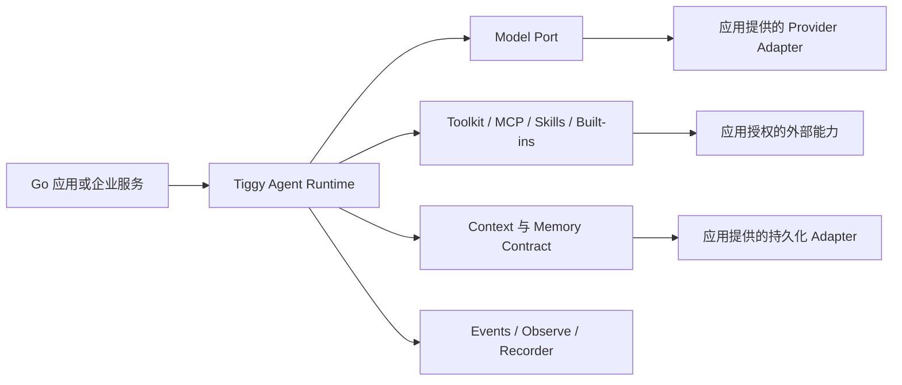

# 让 Agent 稳定运行，而不只是跑起来：推荐 Tiggy Agent Runtime

很多 Agent 项目最初都进展得很快：接入一个大模型，写几个 Tool，再加一个循环，一个可以演示的 Agent 就完成了。

真正困难的部分通常发生在它开始承载实际工作之后：模型偶尔超时，Tool 执行到一半失败，上下文越积越长，Memory 混入错误范围的数据，调用取消后仍有后台操作继续运行，日志很多却无法还原一次 Run 到底发生了什么。

这些问题不是 Prompt 能解决的，也不只是换一个模型就会消失。它们属于 Agent Runtime 的工程问题。

Tiggy Agent Runtime 正是为这个阶段设计的：一个可嵌入 Go 应用、与模型 Provider 无关、强调运行可靠性和诊断能力的工具型 Agent Runtime。

> 如果你已经能做出 Agent Demo，下一步关心的是它能否稳定执行、出现异常后能否解释、扩展能力是否仍然受控，那么 Tiggy Agent Runtime 值得关注。

## 它是什么

Tiggy Agent Runtime 是一个进程内 Go Library。应用通过 Go Module 导入它，在自己的进程中构造和运行 Agent：

```text
Go Application -> import tiggy-agent-runtime -> Agent runs in the same process
```

它不是 OpenAPI Client SDK，也不是必须独立部署的 Agent 服务。模型凭证、数据库、HTTP API、租户、Worker 和企业审批流程仍由宿主应用拥有。

它的架构可以概括为：



Core 定义运行协议、边界和不变量；应用负责选择并注入具体 Adapter。这使同一个 Runtime 可以嵌入命令行工具、后台服务或企业平台，而不把其中任何一种部署形态写死在 Core 中。

## 为什么值得推荐

### 1. 它首先关心一次 Run 是否正确结束

Tiggy 使用有明确上限的 ReAct Loop。迭代次数、Model Call、Tool Call、Token 和总执行时间都有边界。

一次 Run 必须产生且只产生一个终止结果：Completed、Failed 或 Canceled。Model、Tool、Memory、Context Extension 和 Event Sink 的 Panic 会在所属边界被转换为结构化失败，而不是直接破坏宿主进程。

错误也不是一段模糊字符串。Runtime 区分 Model、Tool Runtime、Invalid Input、Limit、Canceled、Event Sink 等错误类别，并保留稳定错误 Code。应用可以据此决定告警、重试、降级或向用户展示什么，而不必解析错误文案。

这类约束看起来没有“多一个 Agent 能力”那么显眼，却是长期运行最重要的基础。

### 2. Context Compression 不会偷偷改写完整会话

上下文管理不只是“超过 Token 就截掉前几条消息”。Tool Call 和 Tool Result 之间存在结构关系，未完成调用不能被拆开；System 指令、Tool Schema、Recall Memory 和输出预留也都占用预算。

Tiggy 在调用模型前显式生成 Token Plan，先预留输出空间，再决定输入范围。当需要压缩时，它按语义组处理历史，并记录压缩覆盖范围、前后 Token、策略版本和 Fallback 结果。

更重要的是，Compression 只改变本次发送给模型的 Request View，不改写 Runtime 保存的完整 State：

```text
完整 State             保留真实会话历史
发送给 Model 的 View   可以经过选择或摘要压缩
```

这让压缩行为可以观察、测试和替换，也避免一次不可靠的摘要永久污染会话事实。

### 3. Memory 有明确边界，但 Core 不强迫你使用数据库

Tiggy 将长期 Memory 拆成 Recall 和 Observe 两个 Port，并明确 Scope、来源、过期时间、容量和冲突策略。

Recall 的结果只进入当前模型请求视图，不会悄悄追加到 Agent State。Observe 只接收已经完成的当前 Turn。跨 Scope、非法来源、越界结果和取消不会被静默接受。

Core 提供 Noop 和有界的进程内实现，方便开发和测试，但不宣称它们具有持久性。PostgreSQL、Vector Store、Embedding、Retention、物理删除和租户隔离属于企业 Adapter。

这种设计既保留了统一契约，也没有把特定数据库和产品数据模型塞进通用 Runtime。

### 4. Toolkit、MCP、Skills 和内置工具使用统一执行协议

Tiggy 同时支持：

- 原生 Tool 和并发安全 Toolkit；
- 带生命周期管理的 MCP Tool；
- 严格 Manifest、显式激活的 Skills；
- Read、Write、Edit、Glob、Grep 和 Bash 等内置工具。

这些能力最终都进入统一的 Tool Call/Result 协议。Tool Definition 在进入模型前校验，参数按 JSON Schema 验证，模型可以修正的业务错误与必须终止 Run 的 Runtime Error 被明确区分。

文件能力限制在 SafeSpace Root 中，并在外部效果前经过类型化 Permission Policy。Bash 必须显式注入 Command Runner；Core 不默认安装本地命令执行器，也不会把工作目录限制夸大成完整安全沙箱。

这意味着扩展能力丰富，但每一种能力仍有清楚的授权、资源所有权和失败边界。

### 5. 可观测性不是在关键路径里随手打印日志

Runtime 为每次 Run 产生版本化 Event Stream。Model Call、Tool Call、Context Preparation、Compression、Memory Recall/Observe 和 Artifact Offload 都有明确的开始与结果事件，事件带 Run ID、Call ID、Parent 和单调 Sequence。

应用可以接入：

- 隐私感知的结构化日志；
- 有界基数 Metrics；
- OpenTelemetry Trace 和 Metric；
- 带版本和 SHA-256 完整性链接的 Run Recorder。

默认 Observer 不记录完整 Prompt、Tool 参数、Memory 内容和原始 Model Delta。Run Recorder 用于事后诊断和发现记录损坏，但它不会被描述成数字签名、持久化执行状态或跨进程恢复机制。

这些边界让“可监控”不等于“把所有敏感数据都写进日志”。

### 6. `agenttest` 让可靠性可以重复验证

很多框架提供 Mock Model，但测试往往只验证“返回了某段文字”。Tiggy 的 `agenttest` 更关心执行协议是否仍然成立。

它提供：

- 按调用顺序编排的 `ScriptedModel`；
- `FuncTool`、`FuncMemory`、Planner、Compressor 和 Offloader Test Double；
- 确定性 ID 和 Clock；
- Event Trace 捕获与生命周期不变量校验；
- 精确到第 N 次调用的 Context/Memory Fault Injection。

测试可以稳定复现 Error、Panic、等待取消、非法结果，以及“Delegate 已产生副作用但确认响应丢失”这类有歧义的失败。

例如，一条测试可以完整验证：

```text
第一次 Model Call 返回 Tool Call
                -> Tool 只执行一次
                -> Tool Result 进入第二次 Model Request
                -> Model 返回最终答案
                -> Trace 只有一个 Terminal Event
```

测试过程中还可以通过 `ScriptedModel.Calls()` 查看每一次真正发送到 Model Boundary 的完整 Context View，并和 Runtime 保留的完整 State 对比。

这对复杂 Agent 系统很重要：可靠性不再只是设计文档里的承诺，而是使用方能够重复运行的测试。

## 它和常见 Agent Framework 的关注点有什么不同

Tiggy 并不试图在所有维度超过所有框架。它的选择更聚焦：

| 常见优先级 | Tiggy Agent Runtime 的优先级 |
|---|---|
| 快速连接更多模型和应用 | 稳定 Provider-neutral Contract，由 Adapter 接入模型 |
| 用少量代码跑出 Demo | 让每次 Run 有边界、结构化失败和唯一终止结果 |
| 自动保存和召回 Memory | 显式 Scope、Provenance、Expiry、Conflict 和降级策略 |
| 上下文超长时直接截断 | Token Plan、语义分组、压缩来源与完整 State 分离 |
| 通过日志观察执行过程 | 版本化 Event、Trace、Metrics 和可校验 Run Journal |
| 普通 Mock 与 Happy Path 测试 | 协议不变量、取消和确定性故障注入 |

如果需求是快速试验大量预置 Agent 模板，其他生态可能更方便。如果目标是把 Agent 作为长期运行的软件组件嵌入 Go 系统，Tiggy 的约束会更有价值。

## 最小使用方式

应用实现 `model.Model`，然后把 Provider Adapter、Toolkit 和可选扩展注入 `agent.Config`：

```go
runtime, err := agent.New(agent.Config{
    Name:          "support-agent",
    SystemPrompt:  "Answer with verified information.",
    Model:         provider,
    ModelIdentity: model.Identity{Provider: "company", Model: "stable"},
    Toolkit:       tools,
    Limits:        agent.DefaultLimits(),
})
if err != nil {
    return err
}

result, err := runtime.Run(ctx, userMessage)
```

Runtime 不读取全局模型凭证。Credential、HTTP Client、连接池、限流和 Provider-specific Wire Mapping 都保留在 `provider` 内部。

项目还提供无需真实模型凭证的基础运行示例，以及能够编译执行的 `agenttest` Model-Tool-Model 示例。

## 哪些团队适合使用

Tiggy Agent Runtime 更适合：

- 使用 Go 构建 Agent 产品或企业后台服务；
- 已经完成 Demo，正在处理超时、取消、上下文和故障诊断；
- 希望 Core 与数据库、租户和部署平台解耦；
- 需要自定义 Model、Memory、Artifact 或 Command Adapter；
- 希望用确定性测试证明运行时不变量。

它目前不适合直接解决：

- 无代码 Agent 搭建；
- 完整的 SaaS 控制台和审批工作流；
- 开箱即用的持久化 Worker 集群；
- 跨进程恢复和 Exactly-once 外部副作用；
- 内置的 Multi-agent Team、RAG 产品或 Voice Pipeline。

这些能力可以由上层产品实现，但不是 Core 当前承诺的一部分。

## 当前状态

Tiggy Agent Runtime 已完成 P0 到 P3 的工程实现，覆盖协议基础、可靠 Agent Loop、Toolkit 与执行环境、Context、Memory、Observability、Run Recorder 和 Fault Injection。

但项目仍处于 pre-v1 阶段，尚未宣称生产可用。仓库已有本地 `v0.1.0` 发布基线；当前 `Unreleased` 能力、真实 Provider Adapter 和企业流程的端到端接入仍需验证，后续公开版本仍必须经过审核并获得 Owner 发布授权。

因此，当前最合适的定位是：

> 一个功能范围已经基本封闭、正在通过真实集成验证公开 API 的可靠 Agent Runtime Core。

## 结语

Agent 的价值来自模型，但 Agent 系统的稳定性来自模型之外的工程约束。

一次调用是否有上限，一次失败是否能分类，一次取消是否能传播，一次上下文压缩是否可解释，一段 Memory 是否属于正确 Scope，一个 Tool 是否会被错误重放，一条 Event Trace 是否能还原完整生命周期。这些问题决定了 Agent 能否从演示走向长期运行。

Tiggy Agent Runtime 没有把这些问题藏在“自动化”背后，而是把它们做成明确的协议、Port、Policy、Event 和 Test。

这正是我推荐它的原因：它不只是帮助 Agent 跑起来，更试图让每一次运行都能够被限制、被观察、被解释，也能够被验证。
